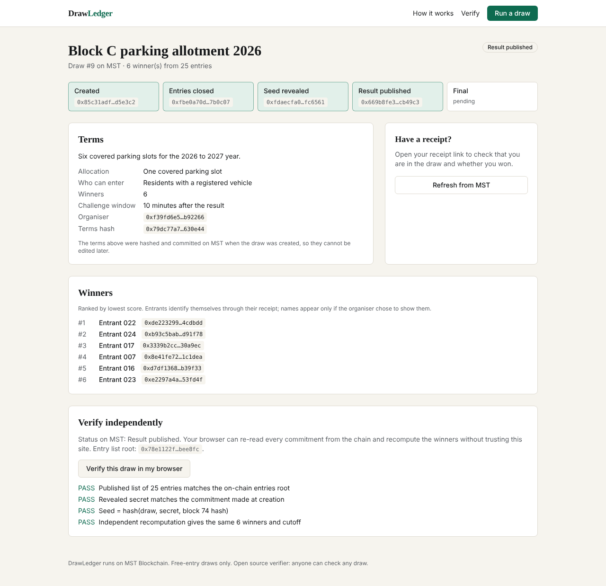

# DrawLedger

**Draws that every entrant can check for themselves.** DrawLedger runs lottery-style allocations (parking slots, event seats, scholarship shortlists, free giveaways) with every input committed on [MST Blockchain](https://www.mstblockchain.com/) before the result can exist. Entrants get a receipt that proves they were in the draw and shows their own result. A wrong result can be proven on-chain, which voids the draw and pays the organiser's bond to the challenger.



https://drive.google.com/file/d/13vdHAMP9ETk-IbTEuNEm47qixHizzksi/view?usp=sharing

## How it works

1. The organiser's browser creates a secret and commits only its hash, the terms hash and a bond on MST.
2. Entrants get salted, pseudonymous entry hashes and a private receipt link.
3. Closing entries commits the sorted list as a Merkle root and fixes a target block 3 blocks ahead.
4. The organiser reveals the secret; seed = hash(draw, secret, target block hash).
5. Score = hash(seed, entry). The lowest scores win. The result is committed as a second sorted Merkle root.
6. During the challenge window anyone can prove an excluded entry, unknown winner, wrong score or unsorted list on-chain.

Details: [docs/architecture.md](docs/architecture.md), [docs/smart-contracts.md](docs/smart-contracts.md).

## Repository layout

```
contracts/        DrawRegistry.sol, SortedMerkle.sol, Hardhat config, tests, deploy and smoke scripts
packages/core/    @drawledger/core: hashing, sorted Merkle trees, selection, verification, challenge planning, CLI
apps/web/         Next.js 15 app: organiser dashboard, public draw pages, receipts, verifier, REST API
docs/             Product, architecture, API, security, testing, deployment, beta plan, grant application
```

## Quick start (local chain)

Requires Node 20 or newer.

```bash
npm ci
npm test                                     # core + contract + protocol end-to-end tests

# terminal 1: local chain
cd contracts && npx hardhat node

# terminal 2: deploy and run the app
cd contracts && npx hardhat run scripts/deploy.ts --network localhost
cd ../apps/web && cp .env.example .env.local
# set NEXT_PUBLIC_CHAIN_ID=31337, NEXT_PUBLIC_RPC_URL=http://127.0.0.1:8545,
# NEXT_PUBLIC_REGISTRY_ADDRESS and NEXT_PUBLIC_REGISTRY_DEPLOY_BLOCK from the deploy output
npm run dev
```

Open http://localhost:3000, add the local network to MetaMask (chain 31337) and import a Hardhat test account. Without `DATABASE_URL` the app uses an embedded Postgres (PGlite) in `apps/web/.data`.

## Deploy to MST Coral Testnet

```bash
cd contracts
cp .env.example .env                         # DEPLOYER_PRIVATE_KEY of a testnet-only wallet, funded from the faucet
npx hardhat run scripts/check-network.ts --network mstCoral
npm run deploy:coral                         # writes deployments/mstCoral.json
npm run smoke:coral                          # runs a real draw, writes deployments/mstCoral-smoke.json
```

Then set the printed values in the web app's environment. Full runbook including hosting with Supabase: [docs/deployment.md](docs/deployment.md).

| Network | Chain ID | RPC | Explorer |
| --- | --- | --- | --- |
| MST Coral Testnet | 54635 | https://coralrpc.mstblockchain.com | https://coral.mstscan.com |
| MST Testnet | 91562037 | https://testnetrpc.mstblockchain.com | https://testnet.mstscan.com |
| MST Mainnet | 4646 | https://mariorpc.mstblockchain.com | https://mstscan.com |

## Verify any draw without trusting this app

```bash
npm run build:core
node packages/core/dist/cli.js --rpc https://coralrpc.mstblockchain.com \
  --registry <registry> --draw <id> --from-block <deploy block> --api <app url>
```

The CLI reads every commitment from the chain, recomputes the seed and the winners, and prints calldata for an on-chain challenge if the result is wrong.

## Tests

| Command | What it covers |
| --- | --- |
| `npm run test:core` | Hashing, trees, selection, challenge planning |
| `npm run test:contracts` | Contract unit and edge cases |
| `npm run test:e2e` | 25, 1,000 and 5,000 entrant draws verified from public data; a rigged draw overturned |
| `npm run coverage -w @drawledger/contracts` | Solidity coverage |
| `apps/web/tests/api-flow.test.ts` | Full HTTP journey against a running app and chain |
| `apps/web/tests/ui_e2e.py` | Real browser journey, screenshots and demo video |

Results: [docs/testing-report.md](docs/testing-report.md).

## Documentation

- [Product definition](docs/product.md)
- [Architecture](docs/architecture.md) and [decision log](docs/decisions.md)
- [Smart contracts](docs/smart-contracts.md) and [HTTP API](docs/api.md)
- [Security assessment](docs/security-assessment.md) and [testing report](docs/testing-report.md)
- [Deployment runbook](docs/deployment.md) and [mainnet readiness](docs/mainnet-readiness.md)
- [Business plan](docs/business.md), [beta plan](docs/beta-plan.md), [buildGrant application draft](docs/grant-application.md)
- Demo recording: [docs/demo/drawledger-demo.mp4](docs/demo/drawledger-demo.mp4) (local chain)

## Scope

DrawLedger is for free-entry draws only. It does not run paid lotteries or games of chance for money.

## License

MIT
