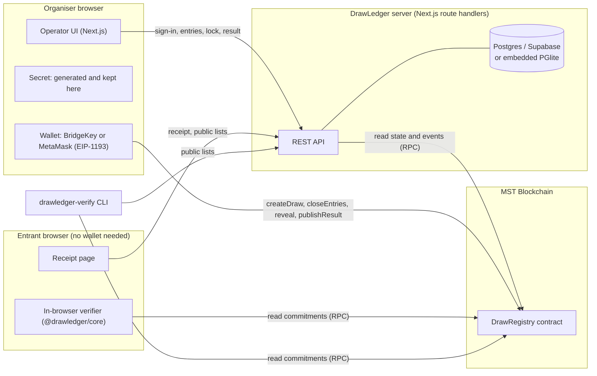
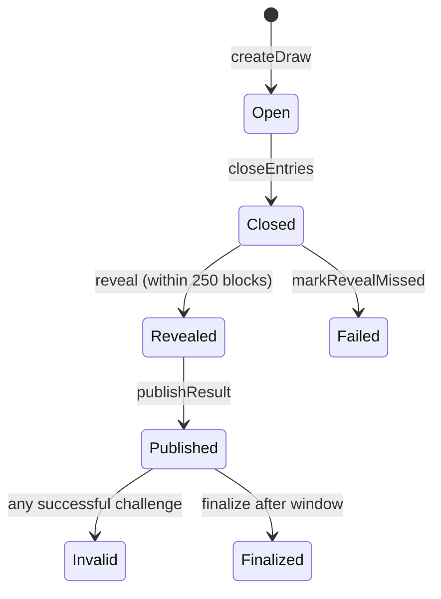
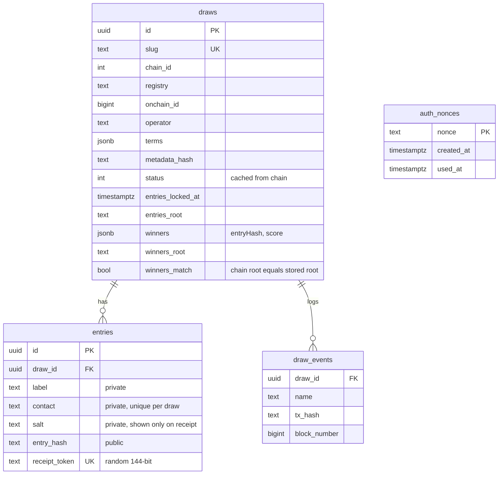
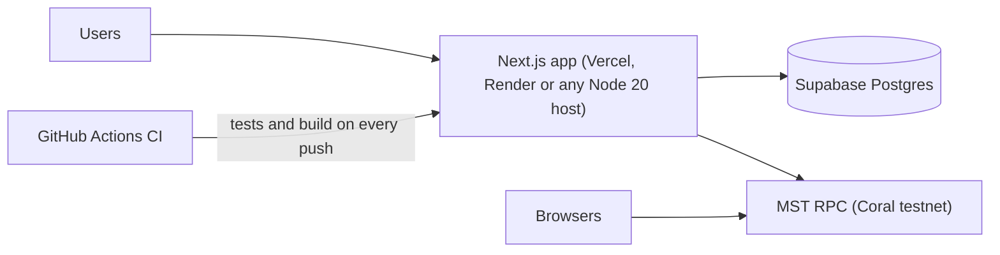

# DrawLedger: technical architecture

## 1. System overview



Design rules that shape everything else:

- **The chain is the source of truth.** The database caches state and holds private data (names, contacts, salts). Every decision that matters (status, roots, seed, result) is read from MST.
- **The server never holds the seed secret.** It is generated and stored in the organiser's browser and revealed by the organiser's own transaction.
- **Everything public is reproducible.** The same `@drawledger/core` library runs in the server, the browser and the CLI, so all parties compute identical hashes and trees.

## 2. Stack and why

| Layer | Choice | Reason |
| --- | --- | --- |
| Contracts | Solidity 0.8.24, Hardhat 2, OpenZeppelin `ReentrancyGuard` | MST is EVM compatible; Hardhat is listed as supported by MST |
| EVM target | `paris` | Avoids the `PUSH0` opcode, so bytecode runs whichever fork MST has enabled (community reports disagree between Shanghai and Cancun) |
| Compiler delivery | Bundled `solc` 0.8.24 (solcjs) | Compiles without downloading binaries; reproducible in CI |
| Chain client | viem | Typed ABI, works in Node and browser, no heavy wallet framework needed |
| Wallet | Injected EIP-1193 provider | BridgeKey (MST's wallet) and MetaMask both inject one; no wagmi needed for five calls |
| App | Next.js 15 App Router, React 19, TypeScript, Tailwind 4 | One deployable for UI and API |
| Database | Postgres via `postgres.js`; PGlite fallback | Supabase-compatible in production; zero setup locally and in tests |
| Auth | Sign-In with Ethereum (EIP-4361) and an HS256 JWT cookie (`jose`) | Operators already have wallets; no passwords stored |
| Validation | zod | Every request body validated at the edge |
| Not used | IPFS, wagmi, shadcn/ui, a separate indexer service | Terms are committed by hash and served by the app; entries lists are small; on-demand log reads are enough at MVP scale |

## 3. Blockchain architecture

### Network parameters (from official and registry sources, Nov 2026)

| Network | Chain ID | RPC | Explorer | Faucet |
| --- | --- | --- | --- | --- |
| MST Coral Testnet (default) | 54635 | https://coralrpc.mstblockchain.com | https://coral.mstscan.com | https://coral-faucet.mstblockchain.com |
| MST Testnet | 91562037 | https://testnetrpc.mstblockchain.com | https://testnet.mstscan.com | not public |
| MST Mainnet | 4646 | https://mariorpc.mstblockchain.com | https://mstscan.com | none |

`contracts/scripts/check-network.ts` prints the live chain ID, block and gas price and fails if the RPC disagrees with the configured chain ID, so these values are verified at deploy time rather than assumed.

### Protocol

```mermaid
sequenceDiagram
  participant O as Organiser browser
  participant S as DrawLedger API
  participant C as DrawRegistry (MST)
  participant E as Entrant

  O->>O: secret = random 32 bytes; save + download
  O->>C: createDraw(hash(operator, secret), hash(terms), k, period) + bond
  O->>S: register(drawId, txHash, terms)
  S->>C: read draw, verify operator and terms hash
  E->>S: sign up (or organiser imports)
  S-->>E: receipt link (salt, entryHash = hash(drawId, salt))
  O->>S: lock entries
  S-->>O: root, count of sorted entry hashes
  O->>C: closeEntries(root, count)  [targetBlock = now + 3]
  Note over C: target block mined, its hash is unknown before
  O->>C: reveal(secret)  [seed = hash(drawId, secret, blockhash(target))]
  O->>S: compute result
  S->>C: read seed
  S-->>O: cutoff, winners root, count
  O->>C: publishResult(cutoff, root, count)  [challenge window opens]
  E->>C: (optional) challenge with Merkle proofs
  O->>C: finalize after window, then withdraw bond
```

### Why the seed is unpredictable

- The organiser commits `hash(operator, secret)` before any entries are frozen, so they cannot pick a secret after seeing the list.
- The target block is fixed by the contract at close time (`block.number + 3`). Its hash does not exist when the organiser committed.
- The validator producing the target block can withhold it to change its hash, but does not know the secret, so cannot aim at an outcome. Only an organiser and validator colluding could bias the draw; a drand beacon input is on the roadmap to close that gap.
- If the organiser does not reveal within 250 blocks of the target (blockhash is only available for 256), anyone can mark the draw failed and the bond goes to the treasury. Withholding is visible and costly, never silent.

## 4. Smart contract design

`DrawRegistry` (`contracts/contracts/DrawRegistry.sol`) holds all draws; `SortedMerkle` is the tree library. Full reference: [smart-contracts.md](smart-contracts.md).

**State machine**



**Selection rule.** score(entry) = keccak256(seed ‖ entryHash). Winners are the min(k, n) lowest scores, published as a tree sorted by score, with cutoff = the highest winning score.

**Why sorted positional trees.** Both trees are over sorted leaves, padded with zero leaves to a power of two, with index-aware proofs and distinct leaf and node prefixes (0x00, 0x01). Sorting makes *absence* provable: an entry is missing from a sorted list exactly when two adjacent leaves bracket it. That gives five challenges:

| Fault | Proof supplied | Contract checks |
| --- | --- | --- |
| ExcludedEntry | entry proof, bracketing winners | entry is in entries tree, its score ≤ cutoff, winners at i and i+1 bracket its score (or it sorts before index 0 or after the last) |
| UnknownWinner | winner proof, bracketing entries | winner's entry hash falls between two adjacent entries (or outside both ends) |
| WrongScore | winner proof | listed score ≠ hash(seed, entry), or score > cutoff |
| UnsortedWinners | two adjacent winners | not strictly ascending (also catches duplicates) |
| UnsortedEntries | two adjacent entries | not strictly ascending |

If none of these is possible, the published set equals the set of entries with score ≤ cutoff, its size is k, so it is exactly the k lowest scores.

**Money handling.** Bonds use pull payments: `finalize`, `markRevealMissed` and challenges credit `withdrawable`, and `withdraw` (non-reentrant) sends funds. A recipient that rejects transfers cannot block any state change.

## 5. Database schema

`apps/web/db/schema.sql`, applied automatically on first connection.



## 6. API

Summary below; request and response details in [api.md](api.md).

| Method and path | Auth | Purpose |
| --- | --- | --- |
| GET /api/auth/nonce | none, rate limited | One-time SIWE nonce |
| POST /api/auth/verify | none, rate limited | Verify signed message, set session |
| POST /api/auth/logout, GET /api/auth/me | session | Session handling |
| GET, POST /api/draws | operator | List own draws; register a draw created on-chain |
| GET, PATCH /api/draws/:id | owner | Full draw incl. private entry data; settings |
| POST, DELETE /api/draws/:id/entries | owner | Add or remove entries before lock |
| POST /api/draws/:id/lock | owner | Freeze entries, return root and count |
| POST /api/draws/:id/result | owner | Compute winners from on-chain seed |
| GET /api/public/draws/:slug | none | Public view |
| POST /api/public/draws/:slug/sync | none, rate limited | Re-read chain state |
| POST /api/public/draws/:slug/signup | none, rate limited | Self-registration when enabled |
| GET /api/public/chain/:registry/:id | none | Ordered entry hashes and winners for verifiers |
| GET /api/receipts/:token | token holder | Receipt with salt |
| GET /api/health, /api/config | none | Liveness of DB and RPC; network config |

## 7. Authentication and authorization

- **Operators** sign an EIP-4361 message containing the app's host, chain ID, a server nonce and a 10 minute expiry. The server checks domain, chain, expiry and signature, consumes the nonce atomically (`update … where used_at is null returning`), then sets an `httpOnly`, `SameSite=Lax`, `Secure` (production) cookie holding a 12 hour HS256 JWT.
- **Authorization** is ownership: every operator route loads the draw by id and compares its stored operator with the session address; mismatches return 404 so draw ids are not enumerable.
- **Registration** is bound to the chain: the server accepts a draw only if the transaction succeeded, targeted the registry, emitted `DrawCreated` with that id, the on-chain operator equals the session, and `hash(terms)` equals the on-chain `metadataHash`.
- **Entrants** have no accounts. Their receipt token (18 random bytes) is a bearer capability for one entry.
- **On-chain authority** never depends on the server: only the operator address can close, reveal or publish, and anyone can challenge or finalise.

## 8. Data flows and privacy

| Data | Where it lives | Who sees it |
| --- | --- | --- |
| Seed secret | Organiser's browser storage and backup file; on-chain only after reveal | Organiser; everyone after reveal |
| Terms | Database and hash on-chain | Public |
| Entrant name, contact | Database | Organiser only (names optionally shown for winners) |
| Salt | Database, receipt | Organiser and that entrant |
| Entry hash | Database, public API after lock, inside on-chain root | Public |
| Winners and scores | Database, public API, root on-chain | Public |

## 9. Deployment architecture



- One Node service runs UI and API; it is stateless except for the in-memory rate limiter (swap for Redis when running more than one instance).
- `DATABASE_URL` points at Supabase (or any Postgres). Without it the app uses PGlite in `./.data`, which suits local development and tests only.
- Environment: `NEXT_PUBLIC_CHAIN_ID`, `NEXT_PUBLIC_RPC_URL`, `NEXT_PUBLIC_REGISTRY_ADDRESS`, `NEXT_PUBLIC_REGISTRY_DEPLOY_BLOCK`, `DATABASE_URL`, `SESSION_SECRET`. No private keys live on the server.
- `/api/health` reports database and RPC status for uptime monitoring.

## 10. Threat model

See [security-assessment.md](security-assessment.md) for findings. The model in brief:

| Actor | Could try to | Prevented or detected by |
| --- | --- | --- |
| Organiser | Choose the seed after seeing entries | Commitment before close; block hash unknown at commit |
| Organiser | Re-roll by not revealing | Bond forfeited, draw publicly failed |
| Organiser | Publish a doctored winner list | Five on-chain challenges; bond paid to challenger |
| Organiser | Add or drop entries after close | Root and count fixed on-chain; receipts prove inclusion |
| Organiser | Stuff the list with own entries before close | Not preventable by cryptography; mitigated by public counts, one entry per contact on public sign-up, and terms committed on-chain. Stated openly as a limit |
| Validator | Bias the target block hash | Does not know the secret; would need to collude with the organiser |
| DrawLedger server | Alter results or leak seeds | Never holds the secret; results checked against chain roots; open verifier |
| Attacker | Steal operator sessions | httpOnly cookies, strict CSP, single-use SIWE nonces bound to domain and chain |
| Attacker | Enumerate receipts or draws | 144-bit receipt tokens, ownership checks returning 404 |
| Attacker | Spam sign-ups or sync | Per-IP rate limits, contact uniqueness, zod validation |
| Attacker | Second-preimage tricks on trees | Distinct leaf and node prefixes; proof length fixed by count |
